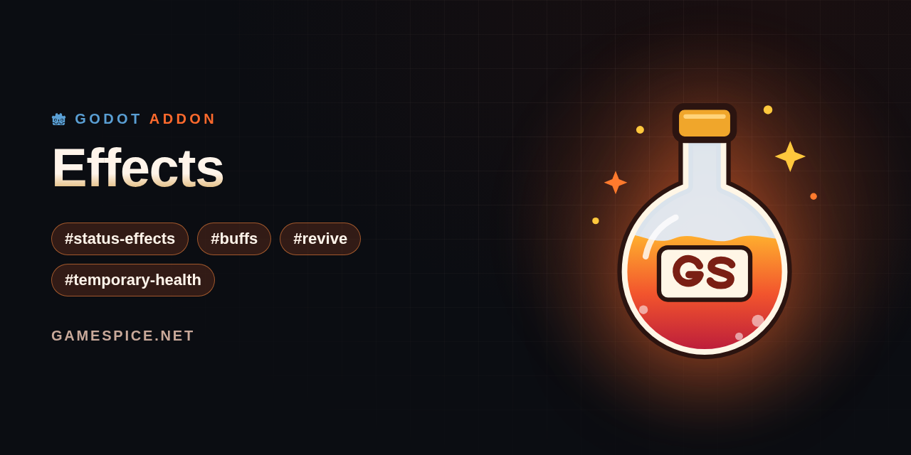

[](https://moddingcommunity.com/a/49-gs-effects)

Status effects, temporary health and going down instead of dying, for Godot 4.7+. Burning, crits, invulnerability, slows, stuns and marks are one data document with different numbers, so a new effect is data and not a new class. Part of the [GameSpice](https://github.com/gamespice-platform) family. It needs only [GameSpice Core](https://github.com/gamespice-platform/core).

GameSpice Effects is a GameSpice addon under the MIT licence, built with Claude Code and tested headless with `res://examples/effects_selftest.tscn`. The games in [Zee's Games](https://zeesgames.com) are built on the GameSpice addons and run on live servers, so status effects run in real matches.

The addon never changes a health value. A burning entity makes the manager emit `damaged` with an amount, and your game applies it the way it applies any damage, so a burn tick goes through the same armour and friendly-fire rules as a bullet. A slowed entity makes `move_speed_scale()` return less than 1, and your movement code reads it. Effects therefore work in a game with no damage system at all.

It has two related systems: temporary health that decays (overheal, pills), and being downed at zero health so a teammate can pick you up.

## Install

1. Copy `addons/gs_effects/` and `addons/gs_core/` into your project.
2. Enable gs-effects in *Project > Project Settings > Plugins*.

[GameSpice Bootstrap](https://github.com/gamespice-platform/bootstrap) clones every project and links the addons for you.

## Quick start

```gdscript
var effects := GSEffectManager.new()
effects.setup()
add_child(effects)

effects.define(GSEffectDef.burning(&"afterburn", 3.0, 10 * 64))  # 3 damage every 32 ticks, for 10 seconds
effects.define(GSEffectDef.damage_buff(&"crit", 3.0, 5 * 64))
effects.define(GSEffectDef.invulnerability(&"invuln", 8 * 64))
effects.define(GSEffectDef.speed(&"adrenaline", 1.4, 15 * 64))

effects.damaged.connect(func(entity, amount, type, source):
    health_of(entity).apply(GSDamage.make(amount, type, source, tick)))

effects.apply(&"afterburn", victim_id, attacker_id)   # a GSResult; refused if the victim is immune
effects.advance(tick)                                 # once per server tick
```

Entities are `int` ids. Ask the manager what an entity's effects add up to wherever you need it:

```gdscript
speed *= effects.move_speed_scale(id)
damage = effects.scale_damage(damage, attacker_id, victim_id)   # crit on one side, a vulnerability on the other
if not effects.may_attack(id): return
```

There are also `may_move`, `may_jump`, `may_capture`, `jump_scale`, `fire_rate_scale` and `is_invulnerable`. Call `on_death(id)` when an entity dies and `on_round_reset()` between rounds, so effects marked to clear then are removed.

## What an effect can do

The four factories above cover the common cases. Everything else is a field on `GSEffectDef`. The numbers are defaults.

| Field | Default | What it does |
| --- | --- | --- |
| `duration_ticks` | 640 | How long it lasts (10 seconds at 64 ticks). |
| `stacking` | `REFRESH` | A second application: `REFRESH` the duration, `EXTEND` it, `STACK` another beside it, or `IGNORE` it. |
| `max_stacks`, `max_duration_ticks` | 1, 0 | Limits for `STACK` and `EXTEND`. 0 means no limit. |
| `per_source` | false | Each attacker gets their own instance, such as a bleed from two players. |
| `tick_interval` | 32 | How often the periodic part fires. |
| `damage_per_tick`, `damage_type` | 0, none | Damage each interval, and its type. |
| `heal_per_tick`, `heal_overheals` | 0, false | Healing each interval, and whether it can go over the maximum. |
| `damage_taken_scale`, `damage_dealt_scale` | 1.0 | Damage multipliers in each direction. |
| `ignores_falloff` | false | Tells your damage code to skip distance falloff. Read it with `state_of(id).ignores_falloff()`. |
| `move_speed_scale`, `jump_scale`, `fire_rate_scale` | 1.0 | Movement, jump and fire rate multipliers. |
| `invulnerable` | false | Takes no damage. |
| `no_attack`, `no_move`, `no_jump`, `no_capture` | false | What the entity cannot do, such as a stun or a freeze. |
| `cures`, `immune_to` | none | Tags this effect removes when applied, and tags it refuses while active. |
| `clear_on_death`, `clear_on_round` | true | Removed on death, and between rounds. |

## Downed instead of dead

Turn on `rules.downed_enabled`, then ask the manager what should happen whenever an entity reaches zero health:

```gdscript
var what := effects.report_zero_health(entity)
if str(what.value) == "down":
    player.play_downed()
else:
    player.die()
```

By default a downed player bleeds out over about 90 seconds. A teammate who holds revive on them for 5 seconds (`begin_revive(entity, by)`) brings them back with 30 health. Moving away, or being downed, cancels the revive and loses the progress. The bleed keeps draining while a revive is held, so a rescue started in the last seconds is a gamble. By default the third time down is death. `position_fn` and `allies_fn` let the manager check that the reviver is close enough and on the same side. `defibrillate()` brings somebody back from dead.

## Settings

The rules live in a `GSEffectRules` resource on the manager's `rules`. The manager makes a default one if you set none. Values layer in the usual order: inspector defaults, a JSON file, the environment, then the command line. Call `load_layered()` before `setup()`:

```gdscript
var rules := GSEffectRules.new()
rules.load_layered("user://effects.json")
effects.rules = rules
```

```bash
GS_EFFECTS_DOWNED_ENABLED=true godot --headless -- --effects-downed-max-incaps=3
```

All numbers are defaults and all are configurable. Ticks assume 64 a second.

| Setting | Default | What it does |
| --- | --- | --- |
| `max_per_entity` | 24 | Most effects one entity can hold at once. A further one is refused. Default 24, 0 = unlimited; negative is refused by `validate()`. |
| `allow_stacking` | true | Off makes every `STACK` effect refresh instead. |
| `downed_enabled` | false | Go down at zero health instead of dying. |
| `downed_health` | 300 | The pool a downed player bleeds through. |
| `downed_bleed_per_tick` | 0.052 | How fast it drains (about 90 seconds). |
| `downed_revive_ticks` | 320 | How long a revive takes (5 seconds). |
| `downed_revive_health` | 30 | Health a revived player comes back with. |
| `downed_revive_radius` | 2.0 | How close the reviver must stay. 0 skips the check. |
| `downed_revive_scales` | false | More revivers make it faster. A second `begin_revive` joins instead of replacing, and `leave_revive(entity, by)` lets one go while the rest carry on. |
| `downed_max_incaps` | 2 | Revives before the next down is death. 0 is unlimited. The inspector slider runs 0 to 64. |
| `downed_defib_health` | 50 | Health after `defibrillate()`. 0 turns it off. |
| `temp_decay_per_tick` | 0.1 | How fast temporary health drains. 0 keeps it. |
| `temp_grace_ticks` | 0 | Ticks after a top-up before it starts to drain. |

The design is in [docs/design.md](docs/design.md).

## Test

```bash
godot --headless --path . --import
godot --headless --path . res://examples/effects_selftest.tscn
```

The self-test is offline and exits non-zero on any failure.

## Used by

### Zee's Games

Zee's Games is a collection of games I made on GameSpice, for demonstration and for fun. They show what the platform can do, and they run on live servers you can join. Anybody can create games on GameSpice, and each addon is its own repository and can be used separately from the games and from the rest of GameSpice.

These games vendor it:

- [Fatal Contact](https://zeesgames.com/fatal-contact) - status effects on players
- [Airdrift](https://zeesgames.com/airdrift)
- [Playlot](https://zeesgames.com/playlot)
- [Zombie Zone](https://zeesgames.com/zombie-zone)

The whole collection is at [zeesgames.com](https://zeesgames.com).

## Licence

MIT. See [LICENSE](LICENSE). Only the TMC back-end web infrastructure is not open source.
